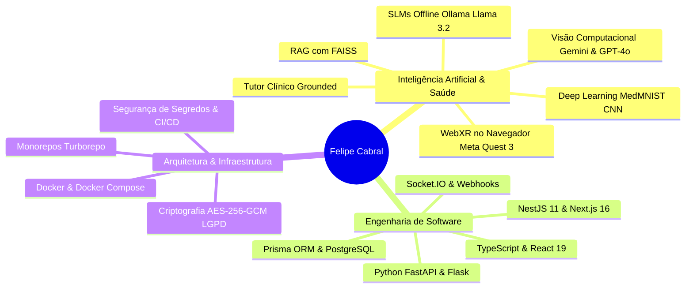

# Felipe Cabral

### Engenharia de Software de Alta Performance · Inteligência Artificial em Saúde

Construção de arquiteturas escaláveis, sistemas imersivos (WebXR/3D) e pipelines de Inteligência Artificial aplicada à Saúde e Automação Resiliente.

---

 

🎓 **FIAP · Graduação em Inteligência Artificial** · Previsão de Formatura: **12/2026** · Coeficiente de Rendimento (Média): **9.57 / 10.0**  
🌐 **Inglês:** Nível **C2 Proficient** (EF SET 72/100)

---

## 👨‍💻 Sobre Mim & Posicionamento Estratégico

Engenheiro de software e pesquisador em **Inteligência Artificial com foco primordial em Saúde (Health AI)** e **Engenharia de Software de Alta Performance**. 

Minha atuação combina rigor arquitetural com aplicações práticas de ponta:
- **IA Aplicada à Saúde & Educação Médica:** concepção de ambientes anatômicos volumétricos em 3D e Realidade Virtual (WebXR para Meta Quest 3), com tutores conversacionais ancorados estritamente em literatura médica (Gray's, Sobotta, Moore, Guyton & Hall) com mitigação de alucinações, além de redes neurais convolucionais (CNNs) para triagem dermatológica (MedMNIST).
- **Engenharia de Software de Alta Performance:** desenvolvimento de monorepos modernos com NestJS 11, Next.js 15/16, mensageria em tempo real via WebSockets/Socket.IO, isolamento multi-tenant, persistência transacional com PostgreSQL e Redis, e criptografia para conformidade com a LGPD (AES-256-GCM).
- **Pipelines Multimodais & Automação Resiliente:** orquestração de Large Language Models (GPT-4o, Gemini Vision) e Small Language Models locais (Ollama / Llama 3.2), sistemas RAG com indexação vetorial (FAISS) e automações orientadas a eventos.

---

## 🏆 Projetos em Destaque

| Projeto | Domínio & Engenharia | Tecnologias Principais |
| :--- | :--- | :--- |
| **1. [VRMed — Estudo de Caso](https://github.com/fecabrall/vrmed-case-study)** | **IA em Saúde · WebXR · Tutoria Médica 3D** Plataforma web imersiva de estudo anatômico volumétrico 3D rodando no Meta Quest 3 sem apps nativos. Tutor médico baseado em GPT-4o ancorado em tratados de anatomia clássicos, comparador de peças anatômicas saudáveis vs. patológicas e telemetria de estudo com relatórios em PDF. Projeto de Iniciação Científica apresentado com demonstração ao vivo no **FIAP NEXT**. | Next.js 16 · React 19 · WebXR · Three.js · React Three Fiber · OpenAI GPT-4o · Tailwind CSS v4 · TypeScript |
| **2. [Omni-Action Hub](https://github.com/fecabrall/omni-action-hub)** | **Automação Multimodal · Visão Computacional** Pipeline que transforma capturas de tela e comandos informais no iMessage em issues técnicas completas no Linear. Utiliza Gemini Vision para extração semântica de falhas, fila SQLite com ACK em ~1s e despacho resiliente de tickets com evidências visuais anexadas. | Python · Gemini 2.5 Flash Vision · Linear API · FastAPI · SQLite · Docker Compose · Shell Scripting |
| **3. [DeliveryHub](https://github.com/viniciusadrian1/deliveryhub)** | **Engenharia de Alta Performance · Monorepo Full-Stack** Hub centralizado multi-plataforma de delivery com 12 sprints e ~14k linhas de código. Hub de pedidos em tempo real com state machine e WebSockets, inteligência de margem cross-platform, conciliação financeira assistida e segurança LGPD desde o dia 1 (AES-256-GCM). | NestJS 11 · Next.js 15 · React 19 · Prisma 6 · PostgreSQL 16 · Redis · Socket.IO · Docker · Turborepo |
| **4. [Predicta — Digital Twin](https://github.com/fecabrall/predicta-digital-twin)** | **Manutenção Preditiva Industrial · RAG Vetorial** Digital Twin e suporte preditivo a decisões operacionais com telemetria em tempo real, enriquecimento de dados via web scraping resiliente, RAG vetorial local com FAISS e SLMs rodando offline (Ollama / Llama 3.2) via Model Context Protocol (MCP). | Python · FAISS · Ollama · Llama 3.2 · Gradio · RPA · IoT · MCP |
| **5. [ARTEMIS Sentinel](https://github.com/fecabrall/artemis-sentinel)** | **Telemetria de Missão · Detecção de Anomalias** Sistema de validação e ingestão de telemetria de voo orbital integrado à API da NASA. Pipeline resiliente de processamento com tratamento de falhas, mascaramento seguro de credenciais e dashboard analítico em tempo real com Streamlit. | Python · NASA API · Streamlit · Pandas · PyTest · Telemetry Pipeline |

---

## 🔬 Outros Projetos Relevantes em Saúde & IA

- **[DermAI](https://github.com/fecabrall/dermAI)**: Aplicação de triagem de lesões dermatológicas utilizando Deep Learning com Transfer Learning (CNN) treinado sobre o dataset Dermatology MNIST (MedMNIST).
- **[Financeiro Apple API](https://github.com/fecabrall/financeiro-apple-api)**: Microsserviço em FastAPI com filtro heurístico local de spam em dois níveis, parsing semântico via Gemini Flash com validação de esquema Pydantic e persistência no Google Cloud Firestore.
- **[SpaceOps Dashboard](https://github.com/fecabrall/spaceops-dashboard)**: Dashboard analítico para monitoramento de rotas e telemetria aeroespacial com pipeline de dados em Python e Streamlit.

---

## 🛠️ Stack Tecnológica & Competências

| Domínio | Tecnologias & Ferramentas |
| :--- | :--- |
| **IA & Saúde (Health AI)** | RAG (FAISS) · Multimodal AI (Gemini Flash, OpenAI GPT-4o) · Grounding Médico · CNNs (MedMNIST) · SLMs Locais (Ollama) |
| **Front-end & Computação Espacial** | Next.js 16 · React 19 · WebXR · Three.js · React Three Fiber · Tailwind CSS v4 · TypeScript |
| **Back-end & Sistemas Distribuídos** | NestJS 11 · Python (FastAPI, Flask) · Node.js · WebSockets / Socket.IO · RESTful APIs · Webhooks |
| **Banco de Dados & Mensageria** | PostgreSQL 16 · Redis · Prisma ORM · SQLAlchemy · Firebase Firestore · SQLite |
| **DevOps & Qualidade de Código** | Docker · Docker Compose · Git / GitHub Actions · Linux · PyTest · Vitest · ESLint |

---

**Arquitetura Robusta · Rigor Metodológico · Inteligência Artificial Aplicada**  
*Desenvolvido por Felipe Cabral · São Paulo, Brasil*

