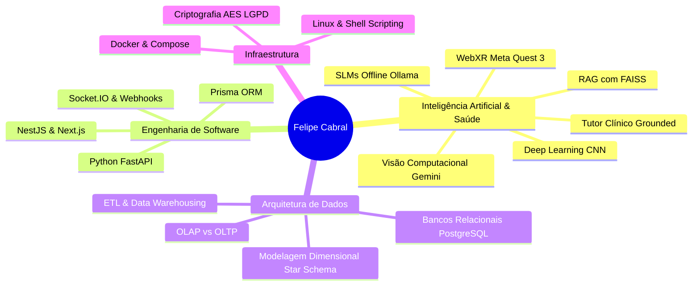

# Felipe Cabral

### Engenharia de Software · Inteligência Artificial em Saúde · Engenharia de Dados

Construção de arquiteturas escaláveis, pipelines multimodais de Inteligência Artificial aplicada à Saúde e modelagem de dados analíticos para ambientes de alta performance.

---

 

🎓 **FIAP · Graduação em Inteligência Artificial** · Previsão: **12/2026** · Coeficiente (Média): **9.57 / 10.0**  
🌐 **Inglês:** Nível **C2 Proficient** (EF SET 72/100)

---

## 👨‍💻 Posicionamento Estratégico

Atuo na convergência entre **Inteligência Artificial (Health AI)**, **Engenharia de Software** e **Arquitetura de Dados**, garantindo que soluções complexas operem sobre bases de dados confiáveis e arquiteturas resilientes.

- **IA Aplicada à Saúde:** Desenvolvimento de ambientes anatômicos em 3D (WebXR), com tutores conversacionais ancorados em literatura médica (Gray's, Sobotta) para mitigação de alucinações, e uso de Deep Learning (CNNs) para triagem dermatológica.
- **Engenharia e Modelagem de Dados:** Estruturação de processos de Data Warehousing e ETL, modelagem dimensional (Star Schema e Snowflake) para separar dados transacionais (OLTP) de cargas analíticas (OLAP) e tratamento de Slowly Changing Dimensions (SCD) para preservação de histórico.
- **Software de Alta Performance:** Arquitetura de microsserviços e monorepos (FastAPI, NestJS), persistência transacional e vetorial (PostgreSQL, FAISS), e pipelines multimodais para automação com Large e Small Language Models (Ollama, GPT-4o).

---

## 🏆 Projetos em Destaque

| Projeto | Domínio & Engenharia | Tecnologias Principais |
| :--- | :--- | :--- |
| **1. [VRMed](https://github.com/fecabrall/vrmed-case-study)** | **IA em Saúde · WebXR · Ensino Médico 3D** Plataforma web imersiva de estudo anatômico 3D no Meta Quest 3. Tutor médico em GPT-4o ancorado em tratados de anatomia e telemetria de sessão em PDF. Validação técnica realizada por **Wagner Sanchez (PhD, FIAP)**, **John Paul Lima** e **Adalton Ramos (Head Tech Unimed)**, com testes práticos pelos influenciadores Gustavo Guanabara e Penegui no FIAP NEXT. | WebXR · Next.js · Three.js · OpenAI GPT-4o · Python |
| **2. [Omni-Action Hub](https://github.com/fecabrall/omni-action-hub)** | **Visão Computacional · Automação Multimodal** Pipeline que transforma capturas de tela no iMessage em issues no Linear utilizando Gemini Vision para extração semântica de falhas e fila SQLite com ACK em ~1s. | Python · Gemini 2.5 Flash Vision · FastAPI · SQLite · Docker |
| **3. [Predicta Digital Twin](https://github.com/fecabrall/predicta-digital-twin)** | **Manutenção Preditiva · RAG Vetorial · Data Engineering** Digital Twin com telemetria em tempo real, enriquecimento de dados via web scraping e RAG vetorial (FAISS) utilizando SLMs rodando offline (Ollama / Llama 3.2). | Python · FAISS · Ollama · Llama 3.2 · RPA · IoT |
| **4. [DermAI](https://github.com/fecabrall/dermAI)** | **Health AI · Deep Learning · Computer Vision** Aplicação de triagem de lesões dermatológicas utilizando arquiteturas de Redes Neurais Convolucionais (CNNs) e Transfer Learning sobre o dataset clínico MedMNIST. | Python · PyTorch/TensorFlow · CNNs · MedMNIST |
| **5. [ARTEMIS Sentinel](https://github.com/fecabrall/artemis-sentinel)** | **Pipeline de Dados · Telemetria Aeroespacial** Ingestão de telemetria de voo orbital integrada à API da NASA com pipeline resiliente de processamento e dashboard analítico. | Python · NASA API · Streamlit · Pandas · ETL |

---

## 🏗️ Projetos de Arquitetura & Infraestrutura

- **[DeliveryHub (Estudo de Caso)](https://github.com/fecabrall/deliveryhub-case-study)**: Documentação arquitetural de um hub de delivery multi-tenant (NestJS 11, Next.js 15, Prisma 6, PostgreSQL 16) focado em WebSockets e isolamento LGPD.
- **[Financeiro Apple API](https://github.com/fecabrall/financeiro-apple-api)**: Microsserviço FastAPI com filtro heurístico local de spam bancário e parsing semântico (Gemini Flash) para conciliação financeira.
- **[SpaceOps Dashboard](https://github.com/fecabrall/spaceops-dashboard)**: Dashboard analítico de observabilidade com pipeline de dados em Python.

---

## 🛠️ Stack Tecnológica & Competências

| Domínio | Tecnologias & Ferramentas |
| :--- | :--- |
| **IA & Saúde (Health AI)** | RAG (FAISS) · Multimodal AI (Gemini, GPT-4o) · Grounding Médico · Deep Learning CNN (MedMNIST) · SLMs (Ollama) |
| **Engenharia de Dados & DBs** | PostgreSQL 16 · SQL · Modelagem Dimensional (Star/Snowflake) · Data Warehousing · ETL / SSIS · SQLite |
| **Back-end & Integrações** | Python (FastAPI, Flask) · NestJS · WebSockets · RESTful APIs · Prisma ORM · Webhooks |
| **Infraestrutura & Computação** | Docker · Linux · WebXR · Next.js · Three.js · Criptografia AES-256-GCM (LGPD) |

---

**Arquitetura Robusta · Rigor Metodológico · Inteligência Artificial Aplicada**  
*Desenvolvido por Felipe Cabral · São Paulo, Brasil*

